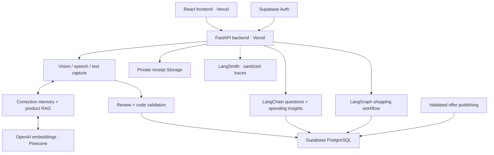

# Technical overview

[Back to README](../README.md)

## Architecture

- **FastAPI** authenticates requests, enforces household membership, coordinates AI calls and exposes review/approval operations.
- **PostgreSQL** stores authoritative purchases, products, budgets, commitments and plans, alongside published offer records.
- **Pinecone** provides embedding-based product/correction retrieval. Financial totals are calculated from confirmed database records.
- **Browser memory** retains chat follow-up context separately from product correction memory.
- **LangSmith** captures sanitized workflow traces, latency and available token usage for inspection and evaluation.

## Technology stack

| Layer | Tools |
| --- | --- |
| Frontend | React, TypeScript, Vite, TanStack Query, CSS/Tailwind tooling |
| Backend | Python 3.14, FastAPI, Pydantic, SQLAlchemy, Alembic |
| AI services | OpenAI vision, speech-to-text, language models and text embeddings |
| AI workflows | LangChain structured interpretation; LangGraph resumable planning |
| Retrieval | Pinecone vector index; product catalogue and correction memory |
| Data and identity | Supabase PostgreSQL, Auth and private Storage |
| Observability | LangSmith; correction-RAG and planner evaluation scripts |
| Hosting | Vercel frontend and FastAPI backend |

Model identifiers and credentials are configurable. No service credentials are included in the repository.

## Verification

The reviewed snapshot passes 254 backend tests and the frontend production build. Model responses in regression tests are simulated. See [AI evaluation](EVALUATION.md) for real-provider component checks and LangSmith feedback, and [performance](PERFORMANCE_RESULTS.md) for query-count results and deployment measurements. Neither live AI accuracy nor a hosted speedup is claimed yet.

The review used Python 3.12; the application declares Python 3.14. Repeat tests using the installed project dependencies before deployment.

## Security and privacy

- Signed Supabase tokens and household membership checks protect API operations. The model cannot choose an authorization scope or execute arbitrary SQL.
- Core purchase, correction and planner migrations include row-level security and browser-role restrictions. Privileged server connections still rely on application-level membership checks; all financial-table permissions need auditing before wider registration.
- Receipt files use private Storage and authorized retrieval. Users can manually cover image details; text checks flag or remove recognizable personal-data patterns. These checks do not guarantee anonymization.
- Audio is sent for transcription before transcript review. AI insights send minimized aggregates rather than raw receipt images or account/purchase identifiers.
- Confirmation and approval remain explicit user actions. LangSmith traces omit receipt and conversation content.
- Environment files, private receipt files and credentials must remain outside version control.

See the [privacy runbook](privacy/00_RUNBOOK.md) for project-specific checks.

## Demo scope and limitations

- Two preconfigured household accounts demonstrate account separation; self-service registration and invitations are future work.
- Sample offers were used because the deadline did not allow enough time to connect a live price source and check its permissions, accuracy and update frequency.
- Receipt history is a partial spending record. Missing receipts are not proof of zero real-world spending, and a large category total is not proof of waste or unaffordability.
- Chat follow-up context is browser-held; persistent server-side chat history is not provided.
- Bonwise uses images, speech and structured purchase records. It does not ingest or answer questions about video content; its household domain departs from the original YouTube-QA brief.

## Future improvements

- Self-service registration, household invitations and membership management.
- Richer purchase insights and correctly scoped comparisons between equivalent periods.
- Verified live retailer APIs or reviewed collection sources, with offer freshness checks.
- Better embedding-assisted retailer matching while retaining brand, variant, pack and unit checks.
- Broader receipt/RAG evaluation and measured latency, token usage and cost.
- Persistent chat history and retention/deletion controls for a wider release.

## Repository guide

| Path | Contents |
| --- | --- |
| `frontend/src` | Application screens and reusable UI components |
| `backend/app/api` | Authenticated HTTP routes |
| `backend/app/services` | Household-scoped records, calculations and approval rules |
| `backend/app/ai` | Model interpretation, product retrieval and tracing |
| `backend/app/workflows` | LangGraph planning and checkpoint handling |
| `backend/alembic` | Database migrations |
| `backend/tests` | Regression and integration tests |
| `scripts` | Setup checks, imports, indexing and evaluation tools |
| `data` | Reference catalogues and evaluation inputs |
| `docs/openapi.json` | Exported API schema; use `npm run generate:api` from `frontend` to regenerate TypeScript API types |

## Feature-to-file map

| Feature | Frontend entry | Backend work |
| --- | --- | --- |
| Receipt/voice/text capture | `purchase/CaptureFlow.tsx` and the capture/review components | `api/image_capture.py`, `voice_capture.py`, `extraction.py`; extraction/transcription in `ai/`; confirmed records in `services/purchases.py` |
| Home and offer comparison | `App.tsx` | `services/shopping_overview.py` and `offers.py`; membership, timezone, catalogue/history and dated offers are read in code |
| Ask Bonwise | `analysis/AskBonwise.tsx` | `ai/analysis_assistant.py` routes intent; `analysis_logic.py` calculates answers; supporting services fetch scoped facts |
| Purchase insights | `analysis/SpendingInsights.tsx` | `services/insights.py` builds facts; `ai/spending_insights.py` selects allowed suggestions |
| Weekly planner | `planner/ShoppingPlanner.tsx` | `services/planner.py`, `planner_context.py`, `workflows/weekly_planner.py` and durable checkpoints |
| Household and budgets | `household/` | `api/household_setup.py`, `services/household_settings.py` and `budgets.py` |
| Request profiling | No custom browser recorder | `core/performance.py` adds content-free `Server-Timing`; use Chrome Performance/Network for rendering and request timing |

The public offer endpoints do not call a language model. Product RAG is used while interpreting/reviewing purchase items; confirmed product links then let the offer service compare compatible published prices.

## Scripts versus application code

The web server does not execute `scripts/` on startup. Setup checks verify configured services; import/index tools maintain reference data; `evaluate_*` tools measure AI components. The purchase workflow/privacy smoke scripts may create test records and should only be used with the intended test household. Database migrations belong in `backend/alembic/versions`, not in one-off migration-generator scripts.

The repository keeps three AI evaluation inputs: correction-RAG labels and planner edits in `data/evaluations`, plus the two synthetic receipt/voice cases defined in the unified evaluation runner. Actual voice recordings remain private. Build logs and styling snapshots do not belong in the AI evaluation results.
