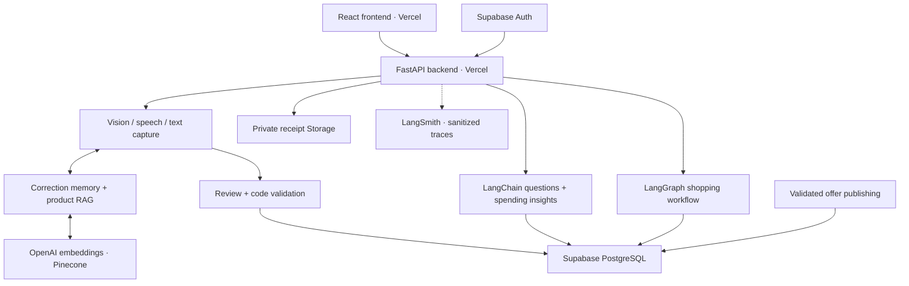

# Technical overview

[Back to README](../README.md)

## Architecture

- **FastAPI** authenticates requests, enforces household membership, coordinates AI calls and exposes review/approval operations.
- **PostgreSQL** stores authoritative purchases, products, budgets, commitments and plans, alongside published offer records.
- **Pinecone** provides embedding-based product/correction retrieval. Financial totals are calculated from confirmed database records.
- **Browser memory** retains chat follow-up context separately from product correction memory.
- **LangSmith** captures sanitized workflow traces, latency and available token usage for inspection and evaluation.

## Technology stack

| Layer | Tools |
| --- | --- |
| Frontend | React, TypeScript, Vite, TanStack Query, CSS/Tailwind tooling |
| Backend | Python 3.12, FastAPI, Pydantic, SQLAlchemy, Alembic |
| AI services | OpenAI vision, speech-to-text, language models and text embeddings |
| AI workflows | LangChain structured interpretation; LangGraph resumable planning |
| Retrieval | Pinecone vector index; product catalogue and correction memory |
| Data and identity | Supabase PostgreSQL, Auth and private Storage |
| Observability | LangSmith; correction-RAG and planner evaluation scripts |
| Hosting | Vercel frontend and FastAPI backend |

Model identifiers and credentials are configurable. No service credentials are included in the repository.

## Verification

The latest refinement passed 218 backend tests and the frontend production build. Ten component interaction checks covered the updated analysis and purchase-history flows. Model responses were simulated; these checks do not measure live extraction quality or certify hosted security. See [release checks](RELEASE_CHECKS.md) for service and deployment verification.

The final budget-card adjustment changes CSS only. Run the backend suite from `backend` with `python -m unittest discover -s tests -v`, and the frontend build from `frontend` with `npm run build`.

## Security and privacy

- Signed Supabase tokens and household membership checks protect API operations. The model cannot choose an authorization scope or execute arbitrary SQL.
- Core purchase, correction and planner migrations include row-level security and browser-role restrictions. Privileged server connections still rely on application-level membership checks; all financial-table permissions need auditing before wider registration.
- Receipt files use private Storage and authorized retrieval. Users can manually cover image details; text checks flag or remove recognizable personal-data patterns. These checks do not guarantee anonymization.
- Audio is sent for transcription before transcript review. AI insights send minimized aggregates rather than raw receipt images or account/purchase identifiers.
- Confirmation and approval remain explicit user actions. LangSmith traces omit receipt and conversation content.
- Environment files, private receipt files and credentials must remain outside version control.

See the [privacy runbook](privacy/00_RUNBOOK.md) for project-specific checks.

## Demo scope and limitations

- Two preconfigured household accounts demonstrate account separation; self-service registration and invitations are future work.
- Sample offers were used because the deadline did not allow enough time to connect a live price source and check its permissions, accuracy and update frequency.
- Receipt history is a partial spending record. Missing receipts are not proof of zero real-world spending, and a large category total is not proof of waste or unaffordability.
- Chat follow-up context is browser-held; persistent server-side chat history is not provided.
- Bonwise uses images, speech and structured purchase records. It does not ingest or answer questions about video content; its household domain departs from the original YouTube-QA brief.

## Future improvements

- Self-service registration, household invitations and membership management.
- Richer purchase insights and correctly scoped comparisons between equivalent periods.
- Verified live retailer APIs or reviewed collection sources, with offer freshness checks.
- Better embedding-assisted retailer matching while retaining brand, variant, pack and unit checks.
- Broader receipt/RAG evaluation and measured latency, token usage and cost.
- Persistent chat history and retention/deletion controls for a wider release.

## Repository guide

| Path | Contents |
| --- | --- |
| `frontend/src` | Application screens and reusable UI components |
| `backend/app/api` | Authenticated HTTP routes |
| `backend/app/services` | Household-scoped records, calculations and approval rules |
| `backend/app/ai` | Model interpretation, product retrieval and tracing |
| `backend/app/workflows` | LangGraph planning and checkpoint handling |
| `backend/alembic` | Database migrations |
| `backend/tests` | Regression and integration tests |
| `scripts` | Setup checks, imports, indexing and evaluation tools |
| `data` | Reference catalogues and evaluation inputs |
| `docs/openapi.json` | Exported API schema; use `npm run generate:api` from `frontend` to regenerate TypeScript API types |

[Demo walkthrough and presentation notes](DEMO_AND_PRESENTATION.md)
